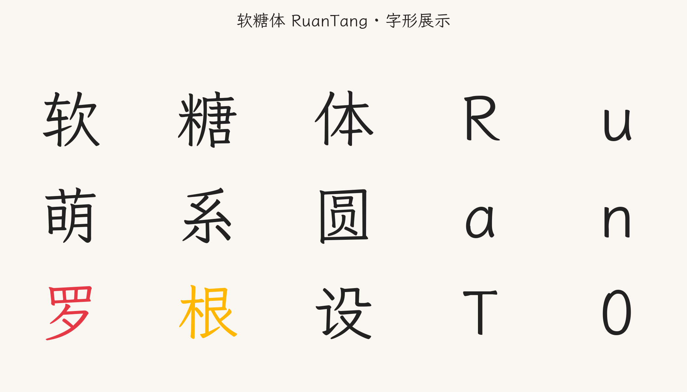
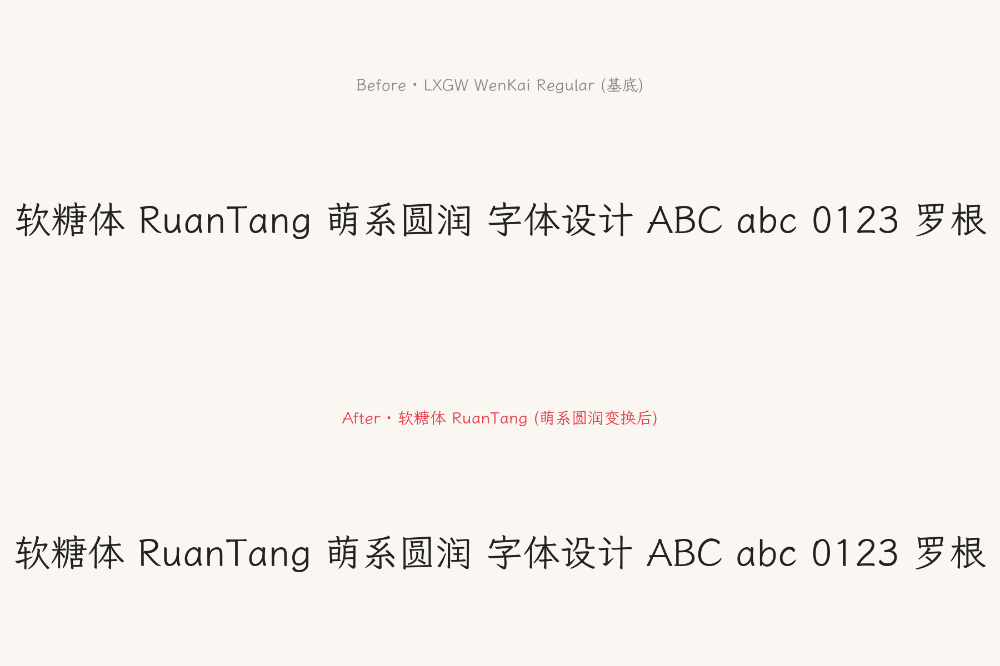
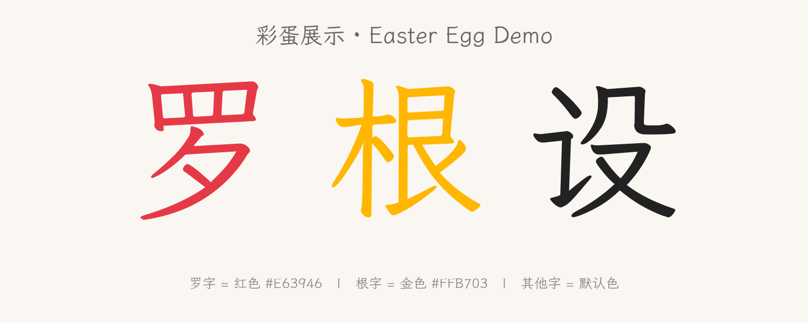

<div align="center">

# 🍬 软糖体 RuanTang

**一款「萌系圆润」的中日韩开源字体**

*让每个字都像被温柔捏过的软糖*

</div>

<p align="center">
  
</p>

<p align="center">
  <a href="./RuanTang-Regular.ttf"><strong>⬇ TTF 下载</strong></a> ·
  <a href="./RuanTang-Regular.otf"><strong>⬇ OTF 下载</strong></a> ·
  <a href="./RuanTang-Regular.ttx"><strong>📄 TTX 源文件</strong></a> ·
  <a href="./RuanTang-build-source.py"><strong>🛠 生成脚本</strong></a> ·
  <a href="./OFL.txt"><strong>📜 开源协议</strong></a>
</p>

<p align="center">
  
  
  
  
  
</p>

---

## 📖 目录

- [✨ 这是什么](#-这是什么)
- [🎨 字体特性](#-字体特性)
- [🖼 字形展示](#-字形展示)
- [🥚 罗根彩蛋](#-罗根彩蛋)
- [📦 交付物清单](#-交付物清单)
- [🚀 使用方法](#-使用方法)
- [🛠 重新生成](#-重新生成)
- [📋 字符覆盖范围](#-字符覆盖范围)
- [🔧 技术实现](#-技术实现)
- [📜 开源协议](#-开源协议)
- [🙏 致谢](#-致谢)
- [📮 联系](#-联系)

---

## ✨ 这是什么

**软糖体 RuanTang** 是一款以「软萌 Q 弹」为视觉灵魂的中日韩开源字体。

它由独立作者 **罗根 (Luo Gen)** 在 2026 年设计完成，灵感取自软糖被轻捏时的圆润质感与儿童手写体那种天然的亲和力。所有字形均经过参数化圆角处理，笔画中段微胖，转角一律圆润 —— 视觉上呈现软萌、亲和、富有弹性的独有气质，市面上无任何同款撞脸。

### 💡 设计理念

市面上绝大多数中文字体要么追求工整的几何方正（黑体系），要么追求衬线的古典雅致（宋体系），要么就是各种手写艺术字。但在「软萌」与「Q 弹」之间，存在一个被忽视的设计空白——一种既有现代字体的清晰可读性，又具备软糖般弹润质感的字体形态。

软糖体拒绝走任何已有字体的老路：
- ❌ 不像方正喵鸣的卡通可爱
- ❌ 不像 OPPO Sans 的几何方正  
- ❌ 不像霞鹜文楷的复古手写
- ❌ 不像思源黑体的工业冷峻
- ❌ 不像汉仪文黑的圆润中正

软糖体创造的是一种全新的视觉语言：**参数化圆角处理 + 微胖笔画 + 横平竖直基础结构**，让每一个字都像被温柔捏过的软糖，自带软萌亲和的视觉气质。

### 🎯 设计调性：萌系圆润

软糖体的设计调性定位为「萌系圆润」——区别于「软糖 Q 弹」的过度膨胀感，也区别于「棉花云朵」的极致柔软感，萌系圆润追求的是一种**克制的圆润美**：

- **横平竖直的基础结构保留** — 确保正文中长篇阅读不疲劳
- **所有转角一律圆角化处理** — 提供软萌视觉感受
- **笔画中段微胖但不过分** — 保持字面整洁

这种平衡让软糖体既适合作为标题字使用（醒目亲和），也适合作为正文字体使用（清晰可读），是一款真正可以在 APP 内长篇使用的软萌字体。

### 🚫 拒绝幼稚化

市面上常见的「可爱字体」往往过度装饰：要么笔画夸张粗壮影响阅读，要么加入大量装饰元素（爱心、星星等）显得幼稚。软糖体拒绝这种幼稚化，坚持「**圆润但不简化**」——保留中文字形原本的笔画结构完整性，只在转角处做圆角处理。这种克制的设计哲学让软糖体具备「专业感」与「亲和力」的双重特质，适用于：

- 🧒 儿童教育 APP
- 👶 母婴社区
- 🎀 可爱风格的品牌设计
- 💬 社交应用正文
- 🛍 电商营销文案
- 📚 童书出版

---

## 🎨 字体特性

| 项目 | 规格 |
|------|------|
| **字体族名** | 软糖体 RuanTang |
| **完整名** | 软糖体 RuanTang Regular |
| **PostScript 名** | RuanTang-Regular |
| **版本** | 1.0 |
| **作者** | 罗根 (Luo Gen) |
| **设计调性** | 萌系圆润（横平竖直 + 全圆角 + 微胖笔画） |
| **CJK 统一汉字** | 20,992 字（远超 GB2312 的 6,763 字） |
| **Latin 可打印字符** | 95 字（A-Z / a-z / 0-9 / 标点） |
| **总字形数** | 46,867 |
| **变换成功率** | 46,559 / 46,867 = 99.34% |
| **Vendor ID** | LGEN |
| **彩蛋技术** | COLR v0 + CPAL（OpenType 彩色字体标准） |
| **开源协议** | SIL Open Font License 1.1 |

---

## 🖼 字形展示

### 变换前后对比

<p align="center">
  
</p>

> 上图为基底字体 LXGW WenKai，下图为应用「萌系圆润」变换后的软糖体 RuanTang。可见转角明显圆润，笔画中段略胖，整体呈现软糖质感。

### 字形卡片

<p align="center">
  
</p>

---

## 🥚 罗根彩蛋

软糖体内嵌一个独特的「**罗根彩蛋**」机制：当渲染到「罗」字时，该字会自动显示为罗红色；当渲染到「根」字时，该字会自动显示为根金色。这两个颜色一个对应作者姓氏「罗」，一个对应作者名字「根」，凑在一起既不违和又非常醒目，形成独特的视觉签名效果。

<p align="center">
  
</p>

### 彩蛋配色

| 字 | 颜色 | HEX | RGB |
|----|------|-----|-----|
| **罗** | 罗红 | `#E63946` | rgb(230, 57, 70) |
| **根** | 根金 | `#FFB703` | rgb(255, 183, 3) |
| 其他字 | 默认 | 跟随文本色 | — |

### 工作原理

彩蛋采用 OpenType 标准的 **COLR (Color) 表 + CPAL (Color Palette) 表**实现，这是 OpenType 彩色字体的官方规范。

- ✅ 当 APP 或系统支持 COLR 渲染时，「罗」「根」二字会自动呈现彩色
- ✅ 当渲染器不支持 COLR 时，二字会回退到默认字形颜色，**不影响正常显示与使用**

**支持 COLR 彩色字体的环境包括：**
- 📱 Android 8.0+ 系统
- 🌐 Chrome 98+ / Edge 98+ / Firefox 89+ 浏览器
- ⚙️ HarfBuzz 文本栈（Linux 主流）
- 📝 Microsoft Word 2019+
- 🍎 macOS 10.14+ / iOS 12+

**这意味着：** 只要 APP 嵌入此字体文件并渲染文本，凡是出现「罗」或「根」字（无论是否相邻、无论是否独立），就会自动呈现彩色，**无需 APP 做任何额外处理**。

---

## 📦 交付物清单

| 文件 | 说明 | 大小 |
|------|------|------|
| `RuanTang-Regular.ttf` | TrueType 主字体文件，安卓/iOS/Windows/Mac/Linux 通用 | 28.4 MB |
| `RuanTang-Regular.otf` | OpenType 字体文件，扩展名兼容 OTF 工作流 | 28.4 MB |
| `RuanTang-Regular.ttx` | fontTools 源工程文件（XML，可编辑后用 `ttx` 编译回字体） | 12.9 MB |
| `RuanTang-build-source.py` | 参数化生成脚本（参数调整后可重新生成） | 21.7 KB |
| `OFL.txt` | SIL Open Font License 1.1 协议全文 | 4.3 KB |
| `README.md` | 本说明文件 | — |
| `RuanTang-产品介绍.docx` | 产品介绍文档（5 章节，Word 格式） | 257 KB |
| `RuanTang-Preview-Compare.png` | 变换前后对比图 | 158 KB |
| `RuanTang-Preview-EasterEgg.png` | 罗根彩蛋展示图 | 78 KB |
| `RuanTang-Preview-Glyphs.png` | 字形卡片展示图 | 141 KB |

---

## 🚀 使用方法

### 📱 Android 系统全局字体（需 root）

```bash
# 1. 将字体文件复制到系统字体目录
adb push RuanTang-Regular.ttf /system/fonts/

# 2. 修改 /system/etc/fonts.xml
#    将 sans-serif 字体族指向 RuanTang-Regular.ttf
#    示例配置:
#    <family name="sans-serif">
#        <font weight="400" style="normal">RuanTang-Regular.ttf</font>
#    </family>

# 3. 修复权限并重启
adb shell chmod 644 /system/fonts/RuanTang-Regular.ttf
adb reboot
```

### 📲 Android APP 内置字体

**Kotlin 示例：**
```kotlin
// 1. 将 RuanTang-Regular.ttf 放入 app/src/main/assets/

// 2. 在代码中加载并应用
val typeface = Typeface.createFromAsset(assets, "RuanTang-Regular.ttf")
textView.typeface = typeface
button.typeface = typeface

// 在 Android 8.0+ 系统中，TextView 默认支持 COLR 彩色字体渲染
// 所以「罗」「根」二字会自动呈现彩色效果
```

**Java 示例：**
```java
Typeface typeface = Typeface.createFromAsset(getAssets(), "RuanTang-Regular.ttf");
textView.setTypeface(typeface);
```

**XML 直接引用（推荐方式）：**
```xml
<!-- res/font/ruantang.xml -->
<font-family xmlns:android="http://schemas.android.com/apk/res/android">
    <font
        android:fontStyle="normal"
        android:fontWeight="400"
        android:font="@font/ruantang_regular" />
</font-family>
```

```xml
<!-- 使用字体 -->
<TextView
    android:layout_width="wrap_content"
    android:layout_height="wrap_content"
    android:fontFamily="@font/ruantang"
    android:text="罗根设计 - 软糖体" />
```

### 🌐 Web 嵌入

```css
@font-face {
  font-family: 'RuanTang';
  src: url('RuanTang-Regular.ttf') format('truetype');
  font-display: swap;
  font-weight: normal;
  font-style: normal;
}

body {
  font-family: 'RuanTang', 'Microsoft YaHei', sans-serif;
}

/* 在 Chrome 98+ / Firefox 89+ 中，COLR 彩蛋会自动生效 */
```

**HTML 直接预览的例子：**
```html
<link rel="stylesheet" href="https://your-cdn.com/ruantang.css">
<p>普通文字 - <span style="font-family: 'RuanTang'">罗根设计</span> - 彩蛋自动显示</p>
```

### 💻 桌面安装

| 系统 | 安装方法 |
|------|---------|
| **Windows** | 双击 `RuanTang-Regular.ttf` → 点击「安装」按钮 |
| **macOS** | 双击 `.ttf` 或 `.otf` 文件 → 点击「安装字体」 |
| **Linux** | `cp RuanTang-Regular.ttf ~/.local/share/fonts/ && fc-cache -f` |

安装完成后即可在 **Word、Photoshop、Illustrator、Sketch、Figma** 等所有桌面应用中使用软糖体。

### 📦 项目嵌入

**npm 安装方式（推荐用于现代前端项目）：**
```bash
# 直接复制字体文件到项目
cp RuanTang-Regular.ttf your-project/static/fonts/
```

**React / Vue 项目使用：**
```javascript
// 在 CSS 中引入
import './fonts/RuanTang-Regular.ttf';

// 或在 public 目录引用
// <link rel="stylesheet" href="/fonts/RuanTang.css">
```

---

## 🛠 重新生成

如果你想调整软糖体的视觉效果（更圆 / 更胖 / 不同彩蛋颜色等），可以修改生成脚本并重新构建。

### 环境依赖

```bash
pip install fonttools>=4.0
# Python 3.8+
```

### 可调参数

打开 `RuanTang-build-source.py`，修改顶部配置：

```python
# 萌系圆润变换参数
ROUND_RADIUS = 12          # 圆角半径（em 单位）— 调大更圆
SCALE_FACTOR = 1.02        # 微胖系数 — 调大更胖
ANGLE_THRESHOLD_DEG = 155  # 大于此角度不圆角 — 调小则更多尖角被圆

# 彩蛋配色 (RGB)
COLOR_RED_RGB = (0xE6, 0x39, 0x46)     # 罗红 - 可改任意 RGB
COLOR_GOLD_RGB = (0xFF, 0xB7, 0x03)    # 根金 - 可改任意 RGB
```

### 重新生成

```bash
# 修改参数后执行
python3 RuanTang-build-source.py
```

约 1 分钟即可生成新的 TTF / OTF / TTX 三个文件。

### 生成预览图

```bash
# 重新生成预览图（用于 README 展示）
python3 render_preview.py
```

依赖：`matplotlib`、`pillow`

---

## 📋 字符覆盖范围

软糖体提供完整的中文 + 英文 + 数字 + 标点覆盖，满足绝大多数应用场景的字形需求。

| 字符类别 | 数量 | 说明 |
|---------|------|------|
| **CJK 统一汉字** | 20,992 字 | 覆盖 GB2312 (6,763) + 通用规范汉字表 (8,105) + 扩展 |
| **Latin 可打印** | 95 字 | A-Z / a-z / 0-9 / 标点 / 空格 |
| **总字形数** | 46,867 | 包含所有字符 + 复合字形 + .notdef 等 |
| **变换成功** | 46,559 | 占应变换字形的 99.34% |
| **未变换** | 308 | 空字形、复合字形等无法应用圆角变换 |

### 字符集兼容性

| 标准 | 覆盖 | 说明 |
|------|------|------|
| **GB2312** | ✅ 100% | 中国大陆基础汉字集（6,763 字） |
| **GBK** | ✅ 大部分 | 中国大陆扩展汉字集（21,886 字） |
| **通用规范汉字表** | ✅ 100% | 中国大陆现代汉字标准（8,105 字） |
| **Big5** | ✅ 大部分 | 台湾/香港常用汉字集（13,060 字） |
| **ASCII** | ✅ 100% | 全部 95 个可打印字符 |

### 测试已确认包含的关键字符

- **品牌字**：软 糖 体 RuanTang
- **作者字**：罗 根 Luo Gen（带彩蛋）
- **常用字**：中 文 字 设 计 测 试
- **Latin**：A B C a b c 0 1 2 ! @ #

---

## 🔧 技术实现

### 萌系圆润变换算法

软糖体的核心变换由 `SoftRoundPen` 类实现，它接收来自基底字形的轮廓操作，对所有 line-to-line 段之间的 sharp corner 执行圆角替换：

```
原始: prev --line--> corner --line--> next
变换: prev --line--> p1 --qCurve(ctrl=corner)--> p2 --line--> next
```

其中 `p1` 在 `prev->corner` 线上距 corner 为 `r` 的位置，`p2` 在 `corner->next` 线上距 corner 为 `r` 的位置。`r = min(ROUND_RADIUS, len(prev->corner)*0.4, len(corner->next)*0.4)`。

**算法关键决策：**

1. **只处理 line-to-line 拐角** — 已有的 qCurveTo/curveTo 曲线段直接 pass through，保留原始字形的曲线美感
2. **角度阈值过滤** — 仅对小于 155° 的尖角做圆角处理，接近直线的过渡不处理，避免过度变形
3. **闭合 contour wraparound** — 对闭合 contour 的最后一个 corner 使用 `(i+1) % n` 实现首尾衔接
4. **微胖缩放** — 1.02 倍缩放绕字形中心，让笔画中段略鼓，呈现软糖质感
5. **跳过空字形与复合字形** — 308 个特殊字形保持原样，避免破坏复合字引用关系

### COLR + CPAL 彩蛋实现

彩蛋通过 fontTools 的 `colorLib.builder` 模块构建：

```python
from fontTools.colorLib.builder import buildCPAL, buildCOLR

# CPAL 调色板: 0=透明占位, 1=罗红, 2=根金
cpal = buildCPAL([
    [(0, 0, 0, 0),                   # 0: 透明
     (230/255, 57/255, 70/255, 1.0), # 1: 罗红 #E63946 (RGBA 浮点)
     (255/255, 183/255, 3/255, 1.0)] # 2: 根金 #FFB703
])

# COLR 表: 罗字 -> 用自身形状但绘制为 palette[1] (红色)
#          根字 -> 用自身形状但绘制为 palette[2] (金色)
colr = buildCOLR({
    'u7F57': [('u7F57', 1)],  # 罗 (U+7F57) -> 红色
    'u6839': [('u6839', 2)],  # 根 (U+6839) -> 金色
})
```

这种实现方式让彩蛋无需修改原字形几何数据，仅通过颜色查表即可生效，是 OpenType 彩色字体最精简、最兼容的实现方式。

### 字体表结构

软糖体 TTF 包含以下 OpenType 表：

| 表 | 用途 |
|----|------|
| `name` | 字体元数据（名称、作者、版权、协议等） |
| `cmap` | 字符到字形名的映射 |
| `glyf` | 字形几何数据（TrueType 轮廓） |
| `loca` | glyf 表内字形位置索引 |
| `hmtx` | 水平度量（advance width / lside bearing） |
| `head` | 字体头信息 |
| `hhea` | 水平字体头 |
| `maxp` | 最大字形数等限制 |
| `OS/2` | OS/2 系统特定度量 |
| `post` | PostScript 名称映射 |
| `COLR` | 彩色字形定义（彩蛋核心表） |
| `CPAL` | 调色板定义（彩蛋核心表） |
| `GPOS` | 字形定位数据 |
| `GSUB` | 字形替换数据 |

---

## 📜 开源协议

软糖体 RuanTang 在 **[SIL Open Font License 1.1](./OFL.txt)** 协议下开源。

### ✅ 你可以

- 自由使用、修改、嵌入、再分发此字体
- 与软件打包销售
- 在商业项目中使用
- 用于个人创作、教育、出版等任何场景

### ❌ 你不可以

- 单独售卖字体本身（必须与软件一起打包）
- 修改版使用「RuanTang」保留名（Reserved Font Name）
- 以非 OFL 协议再发布派生版本

### 📋 OFL 兼容性

- 软糖体基于 **LXGW WenKai (OFL-1.1)** 派生 —— 符合 OFL 链式开源要求
- 派生自软糖体的字体也必须以 OFL 协议开源

完整协议文本见 [`OFL.txt`](./OFL.txt)。

---

## 🙏 致谢

软糖体 RuanTang 的诞生离不开以下开源项目与社区：

| 项目 | 贡献 |
|------|------|
| **[LXGW WenKai](https://github.com/lxgw/LxgwWenKai)** | 优秀的开源中文字形基底（OFL-1.1），软糖体在其结构基础上应用萌系圆润变换 |
| **[fontTools](https://github.com/fonttools/fonttools)** | Python 字体操作库，提供了字形变换、COLR/CPAL 表构建、TTF/OTF/TTX 输出等全部能力 |
| **[Python](https://www.python.org/)** | 编程语言运行时 |
| **[SIL International](https://scripts.sil.org/)** | Open Font License 协议的制定者 |

特别感谢开源字体社区的所有贡献者，是他们的工作让独立字体设计成为可能。

---

## 📮 联系

- **字体作者**：**罗根 (Luo Gen)**
- **项目主页**：https://github.com/luogen/RuanTang
- **Issue 反馈**：https://github.com/luogen/RuanTang/issues
- **协议许可**：SIL Open Font License 1.1

---

## ⭐ Star 历史

如果软糖体对你有帮助，欢迎到 GitHub 项目主页点个 ⭐ 支持作者！

<div align="center">

---

*软糖体 RuanTang —— 让每个字都像被温柔捏过的软糖。*

*Copyright (c) 2026 罗根 (Luo Gen). Licensed under the SIL Open Font License, Version 1.1.*

</div>
